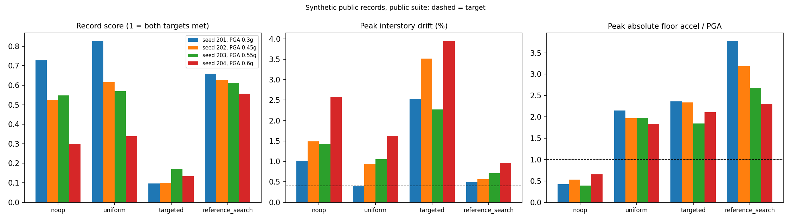

# SeismoLab-Retrofit

A small seismic retrofit design benchmark built on [OpenSeesPy](https://opensees.berkeley.edu/). You choose how much to strengthen each story of a weak 3-story reinforced-concrete frame under a cost budget. A scorer runs nonlinear time-history analyses and rates the result.

Status: early prototype (v0.1). Developed with AI assistance. Not research-grade, not a design tool, not code-compliance software.

## The task

Frame: 3 stories (4 m soft first story, then 3 m, 3 m), 2 bays of 5 m, 300x300 mm columns, 250x450 mm beams, fiber sections (Concrete01 / Steel02), P-delta, 5% Rayleigh damping. Gravity load is applied first and held constant during the dynamic analysis. Units inside the model are N, mm, s (masses in tonnes).

Design JSON (all lists have 3 entries, one per story):

```json
{"jacket_mm": [0, 0, 0], "brace_mm2": [1000, 1000, 1000]}
```

- `jacket_mm` 0-150: concrete jacket thickness on all columns of the story. A jacket adds concrete (same strength, perfect bond) around the original section; it adds no reinforcement and the original bars stay in place.
- `brace_mm2` 0-4000: area of an X brace in the first bay (elastic-plastic, fy 355 MPa, same strength in tension and compression, so brace buckling is NOT modeled).
- Cost is in relative units: `1e-3 * added jacket concrete volume / 1e3 + 8e-3 * brace steel volume / 1e3` (see `cost()`). Budget is 5000. A design over budget scores 0 and no analysis is run.

Scoring (per record, then the minimum over records is the final score):

`record = 0.7 * ramp(max interstory drift: 0.4% target -> 2.0% limit) + 0.3 * ramp(peak ABSOLUTE floor acceleration / record PGA: 1.0 target -> 3.0 limit)`

A record that does not converge (after smaller substeps and a line-search fallback) or produces non-finite values scores 0, so non-convergence is never an advantage. Floor acceleration is absolute (relative acceleration plus ground acceleration), taken over all floors and column lines; drift is taken over all stories and column lines.

## Records are synthetic and public

The 4 scoring records (`SCORING_SUITE` in `retrofit/evaluator.py`) are generated envelope-modulated sums of sinusoids with PGA 0.30-0.60 g. They are not real ground motions. The seeds are in the repository, so this is not a private or hidden evaluation. A real benchmark would need private cases and real records.

## Interface

- Input schema: `retrofit/schema.json` (JSON Schema). Output schema: `retrofit/result.schema.json`.
- CLI: `python -m retrofit.evaluator design.json [--suite scoring|public] [--substeps N]` prints one line `RESULT_JSON {...}` on stdout (OpenSees prints its own warnings to stdout/stderr too, so read the line with that prefix). Exit code 0 = scored, 2 = invalid submission. An invalid submission (bad JSON, NaN, wrong keys/lengths/types/ranges, missing or unreadable file) returns `score: 0` with an `error` string and no traceback.
- Python: `retrofit.evaluator.evaluate(design, suite=None, sub=1)`.

## Usage

```
pip install -e ".[dev]"
python -m retrofit.evaluator retrofit/data/uniform.json     # score one design
python -m retrofit.make_results out.json figure.png         # reference designs + figure
python -m retrofit.reference_search <0-3>                    # grid baseline, 4 parts
python -m retrofit.validation                                # independent checks
pytest -q
```

## Measured results

One machine, Python 3.10, OpenSeesPy 3.7.1. Two full runs produced identical numbers (`results/retrofit_results.json` vs `results/retrofit_results_repeat.json`).

| design | cost | score |
|---|---|---|
| no retrofit | 0 | 0.300 |
| uniform (50 mm jackets, 500 mm^2 braces) | 2245 | 0.338 |
| story 1 only (100 mm, 1500 mm^2 in story 1; small in story 2) | 2591 | 0.096 |
| best of a 16-design grid (`reference_search`) | 1477 | 0.557 |



Notes:

- "No retrofit" scores 0.3, not 0: it fails the drift term at 0.6 g (2.6%) but the very flexible frame (T1 about 2.1 s) keeps absolute floor acceleration below the PGA, so the acceleration term is full.
- Strengthening only the first story is worse than doing nothing in these runs: drift moves into the upper stories. This is one observation on one simplified model, not a design rule.
- The grid result is a lower bound on what is attainable. It is not an optimum (16 designs; jackets uniform, braces on a few profiles). Earlier attempts with random and coordinate search gave 6 to 8 evaluations in the time limit and were not better.

### Is a score of 1.0 attainable?

Not shown, and probably not in this model. The two terms pull against each other: acceleration at or below the PGA needs a flexible frame (period well above 1 s here), while drift at or below 0.4% under the 0.6 g record needs a stiff one. Among the designs tried, drift reaches 0.49-0.97% and acceleration ratio 2.3-3.8 for the best-scoring one, and no design met both targets on all records. The targets (drift 0.4% to 2.0%, acceleration 1x to 3x PGA) are illustrative benchmark scoring choices. They are not code limits or safety thresholds, and they were not tuned to make 1.0 reachable. Only the acceleration anchor has a physical argument (a rigid structure sees absolute acceleration near the PGA). An earlier version used relative roof acceleration, which is not a floor acceleration; that was removed.

## Timestep sensitivity (`results/timestep_sensitivity.json`)

Same records, analysis step = record dt / substeps (0.02 s, 0.01 s, 0.005 s). Scores are the final (worst-record) scores.

| design | 1 | 2 | 4 |
|---|---|---|---|
| no retrofit | 0.300 | 0.300 | 0.300 |
| reference grid design | 0.557 | 0.578 | 0.570 |

Peak drift changes by under 2% across steps for both designs. Peak absolute floor acceleration is the sensitive metric: for the braced reference design the ratio on the 0.6 g record moves from 2.31 to 1.95 and on the 0.55 g record from 2.68 to 3.13, so scores of stiff designs carry roughly a few percent of numerical noise, and rankings closer than that should not be trusted. The shipped scorer uses 1 substep.

## Validation (`results/validation_output.txt`, `results/pytest_output.txt`)

- Elastic cantilever tip deflection vs P L^3 / 3EI: matches.
- SDOF period vs closed form: 0.003% error.
- Elastic SDOF time history (Newmark) vs an independent RK4 solution of the same equation: peak displacement 0.044% error.
- Frame gravity equilibrium: base reactions equal applied load.
- Nonlinear fiber column pushed to 4% drift at zero axial load: with steel hardening switched off (b=0) the base moment is 52.2 kN m, within 1.7% of the plastic couple As fy z = 53.1 kN m. With the model's 1% hardening it is 67.3 kN m, so hardening is what raises the moment (isolated by the b=0 run). The base reaction equals the base-section moment (equilibrium).

### External documented case (elastic only)

`python -m retrofit.external_validation` reproduces the 7-story, 2-bay elastic frame from the [OpenSeesPy documentation](https://openseespydoc.readthedocs.io/en/latest/src/PortalFrame2d.html), whose published table compares OpenSees with the SAP2000 Verification Manual (Example 1) and SeismoStruct Verification Report v6 (Example 11). Output in `results/external_validation_output.txt`: all 7 periods agree with the published SAP2000 values to the published 4 decimals (largest difference 4.3e-5 s), and top displacement, base axial force and base moment agree to the published precision. **This is an elastic check** of beam-column, rigid-floor and eigen machinery. It does not validate nonlinear fiber behavior, time-history analysis, or the retrofit scorer.

Validation gap (material): there is no independent check of the concrete law, cyclic hysteresis under dynamic loading, brace behavior, the frame's nonlinear dynamic response, or of results against experiments or published analyses. The column check covers only monotonic steel-dominated flexure at zero axial load.

## Limitations

- Synthetic public records; results say nothing about real hazard or real buildings.
- 2D frame, fiber beam-columns only: no joints, shear, bond-slip, infill, soil-structure interaction, or brace buckling.
- Relative cost units, not real prices.
- Scores depend on solver tolerances and time step (see sensitivity table); the analysis is deterministic on one machine, not tested across OpenSeesPy versions or platforms.
- Built with AI assistance.
